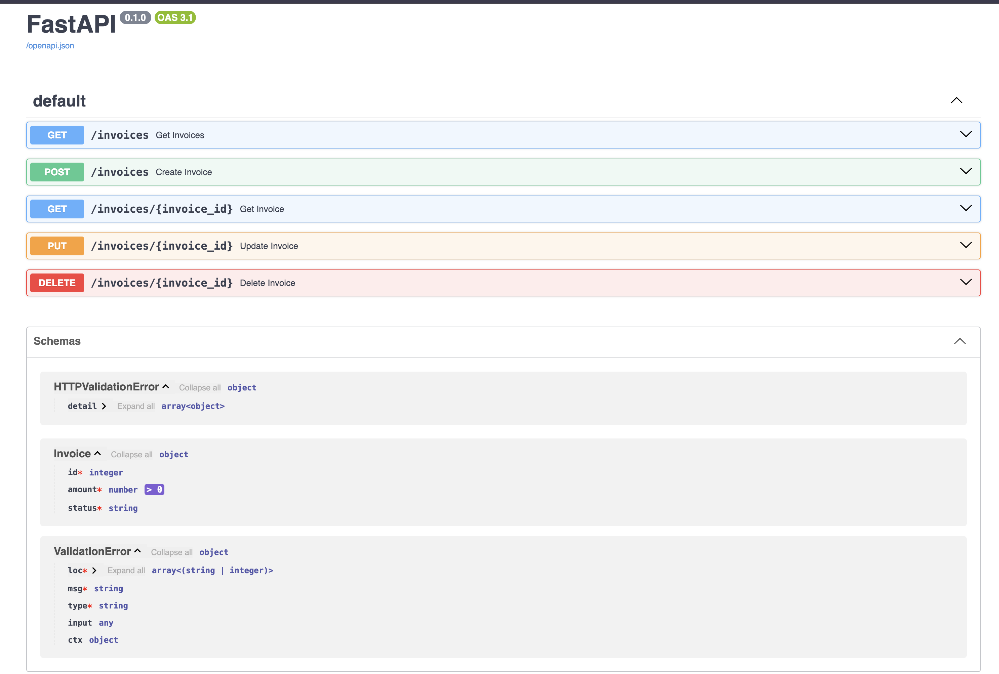
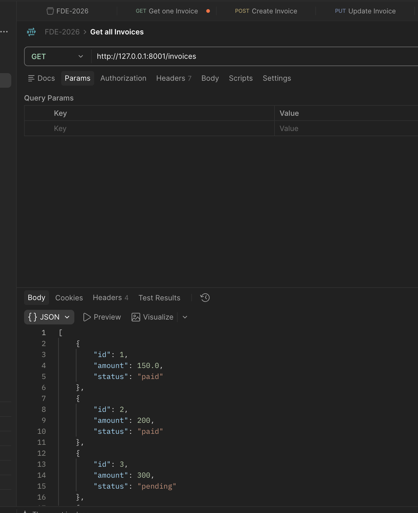

# Invoice API

FastAPI app for listing, creating, updating, and deleting invoices. Data is loaded from `data_store.json` at startup and written back on create, update, and delete so changes persist across restarts.

## Setup / Run

1. Activate the project virtual environment (from the repo root if needed):

```bash
source ../.venv/bin/activate   # or your venv path
```

2. From this folder, start the server:

```bash
uvicorn main:app --reload --port 8001
```

- API base URL: http://127.0.0.1:8001
- Swagger / OpenAPI docs: http://127.0.0.1:8001/docs

## Invoice model

| Field | Type | Notes |
|---|---|---|
| `id` | int | Required in the request body for create/update; create overwrites it with `len(invoice_list) + 1` |
| `amount` | float | Must be greater than 0 |
| `status` | string | e.g. `pending`, `paid` |

Invalid bodies return **422**. Missing invoices return **404**.

## API endpoints

### `GET /invoices`

Returns all invoices.

**Request**

```bash
curl http://127.0.0.1:8001/invoices
```

**Response `200`**

```json
[
  { "id": 1, "amount": 100, "status": "pending" },
  { "id": 2, "amount": 200, "status": "paid" },
  { "id": 3, "amount": 300, "status": "pending" },
  { "id": 4, "amount": 400, "status": "paid" }
]
```

---

### `GET /invoices/{invoice_id}`

Returns one invoice by id.

**Request**

```bash
curl http://127.0.0.1:8001/invoices/1
```

**Response `200`**

```json
{ "id": 1, "amount": 100, "status": "pending" }
```

**Response `404`**

```json
{ "detail": "Invoice not found" }
```

---

### `POST /invoices`

Creates an invoice and saves it to `data_store.json`.

**Request**

```bash
curl -X POST http://127.0.0.1:8001/invoices \
  -H "Content-Type: application/json" \
  -d '{"id": 0, "amount": 50, "status": "pending"}'
```

**Response `200`**

```json
{ "id": 5, "amount": 50.0, "status": "pending" }
```

**Response `422`** (invalid body, e.g. `amount <= 0` or missing fields)

```json
{
  "detail": [
    {
      "type": "greater_than",
      "loc": ["body", "amount"],
      "msg": "Input should be greater than 0",
      "input": 0
    }
  ]
}
```

---

### `PUT /invoices/{invoice_id}`

Updates an existing invoice and saves it to `data_store.json`. Path `invoice_id` is kept; body `id` is overwritten with the path id.

**Request**

```bash
curl -X PUT http://127.0.0.1:8001/invoices/1 \
  -H "Content-Type: application/json" \
  -d '{"id": 1, "amount": 150, "status": "paid"}'
```

**Response `200`**

```json
{ "id": 1, "amount": 150.0, "status": "paid" }
```

**Response `404`**

```json
{ "detail": "Invoice not found" }
```

---

### `DELETE /invoices/{invoice_id}`

Deletes an invoice by id, saves the updated list to `data_store.json`, and returns the removed record.

**Request**

```bash
curl -X DELETE http://127.0.0.1:8001/invoices/1
```

**Response `200`**

```json
{ "id": 1, "amount": 100, "status": "pending" }
```

**Response `404`**

```json
{ "detail": "Invoice not found" }
```

## Swagger evidence

Open http://127.0.0.1:8001/docs, exercise the endpoints, and attach a screenshot of the Swagger UI as assignment evidence.

## Swagger evidence


